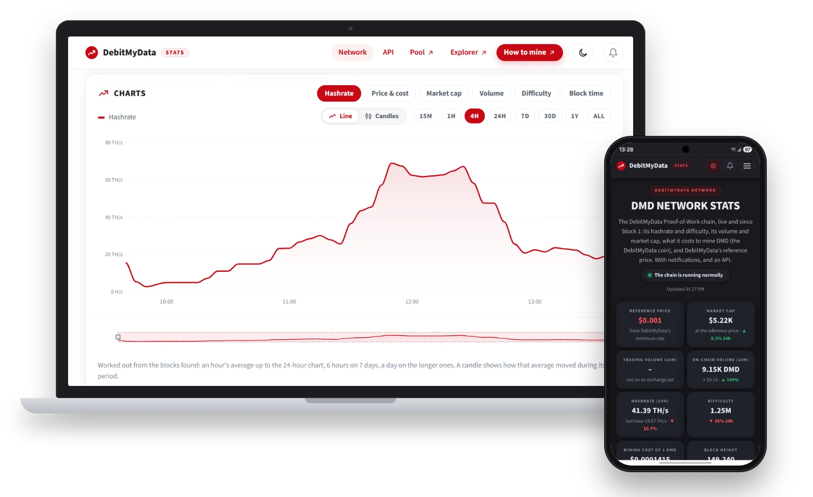

# DebitMyData monitor

The monitoring server of the DebitMyData Proof-of-Work chain, and its public page
**[stats.debitmydata.io](https://stats.debitmydata.io)**.

<p align="center">
<picture>
  <source media="(prefers-color-scheme: dark)" srcset="docs/images/stats-devices-dark.webp">
  
</picture>
</p>

On one Ubuntu 24.04 server:

- **The chain watch** (`chainwatch/`): keeps every block since block 1 in its database, works out
  the hashrate, the volume, every address's balance (its own rich list) and the mining cost of DMD
  (the DebitMyData coin) from them, records the DebitMyData Gateway's reference price (and the
  exchanges' figures once DMD trades on one), compares its own node with the other views of the
  chain, and sends the alerts.
- **DMD Stats** (`web/`): the public page, [stats.debitmydata.io](https://stats.debitmydata.io),
  in DebitMyData's Aurora design (`web/css/aurora.css`, the same as debitmydata.io's),
  with CoinMarketCap-style charts since block 1 (lines or candles, from 15 minutes to everything,
  with a zoom bar), notifications that each visitor chooses, and an API
  ([stats.debitmydata.io/api/](https://stats.debitmydata.io/api/)). It installs as an app on
  phones and computers, the same way as the pool's.
- **The notifications service** (`dmd-chainwatch notify`): the page's notifications (web push),
  as each device chose them.
- **Grafana**: the team's dashboards (the chain, the servers), on its own address, behind a sign-in.
- **Prometheus**: a year of the monitoring server's and the pool server's figures (CPU, memory,
  disks, the pool's node, stratum, database, jobs). Its alerts go out with the chain watch's.
- **The pool agent** (`pool-agent/`): sends the pool server's figures to the monitor through a
  private WireGuard tunnel that the pool server opens. No port opens on the pool server.

The monitoring server runs **its own DebitMyData node**: a third view of the chain, independent of
the pool's and the gateway's. It holds no keys and no coins.

## What it watches

| Alert | Level | Who gets it |
| :-- | :-- | :-- |
| No new block for 30 minutes (warning), an hour (critical) | warning / critical | team |
| This server's node and a view of the chain (the public explorer, the mempool explorer, the pool's node) have **different blocks** at the same height, 2 checks in a row: a fork | critical | team |
| A view is more than 3 blocks behind or ahead | warning | team |
| The chain was **reorganized**: 2 blocks or more replaced (critical from 6, the confirmations DMD payments need) | warning / critical, sent once | team (public if `DMDW_PUBLIC_REORGS=yes`) |
| A competing branch, invalid blocks | warning, sent once | team |
| A miner outside the pool found a quarter of the last 144 blocks | warning | team (public if `DMDW_PUBLIC_CONCENTRATION=yes`) |
| One address got half of the pool's payouts in the last 144 blocks (PPLNS: its share of the pool's hashrate) | warning | team |
| The hashrate jumped (3 times the day's usual) or dropped (a third), within an hour | sent once per 6 hours | team and public |
| The difficulty moved 50% in a day (the last hour's average against the same hour a day before) | sent once a day | team and public |
| One of the rich list's **top 10 addresses** sent or received 1,000 DMD or more in a transaction (not its mining rewards, not the pool's own addresses) | sent once | team (public if `DMDW_PUBLIC_RICHLIST=yes`) |
| The reference price moved 5% or more | sent once | team and public |
| The gateway's reference price stopped updating (30 minutes) | warning | team |
| This server's node: not on the main chain, still syncing, no peers, not answering | warning / critical | team |
| The servers: disk almost full or full, memory short, restarted; the pool server unreachable, its stratum not listening, its node down, behind or without peers, its database down, a job (main, loop2, blocks) stopped | warning / critical | team |
| The day's summary, after midnight UTC | — | public |
| The chain watch itself stopped, or the notifications service (the watchdog, every 5 minutes) | critical | team (Discord) |
| Tor stopped, cut off, or too old and could not be upgraded; the node no longer going through it (`dmd-tor-check`, every 30 minutes; it also repairs what it can) | warning | team (Discord) |

"Team": email and the private Discord channel, critical alerts with a mention. Ongoing ones are
repeated while they last (critical every 2 hours, warning every 12 hours) and sent again when they
end. "Public": the community's Discord channel, without reminders. The levels are in
`/etc/debitmydata-monitor/monitor.env` (below).

## The stats page's notifications

Anyone can turn them on from the stats page, with the bell in the top bar (on the API page too)
or the Notifications card, without an account, the same way as the pool's: the browser asks for
permission, and the device gets a notice even when the page is closed (on an iPhone, from the app
on the Home Screen). Each device chooses, each with its own figure:

| Group | Choices |
| :-- | :-- |
| The network | every new block; the hashrate, the difficulty (the hour's average) or the reference price moving by a chosen percentage since the last notice (each: up or down, up only, or down only); the reference price reaching prices of one's own (up to 5, again each time it comes back to one); transfers of a chosen size; no new block for a chosen time (and when they come again); the halving (a day before, and when it happens); the daily summary |
| The chain's safety | the chain needs attention (blocks stopped, a fork between views) and when it is normal again; reorganizations of a chosen depth; competing branches and invalid blocks; a new miner; one miner finding a chosen share of the blocks (and when it goes back under) |
| Pools and miners | up to 10, by name: each block it finds; its hashrate moving by a chosen percentage; no block from it for a chosen time (and when it finds one again) |
| Wallet addresses | the top 10 of the rich list moving a chosen amount; up to 10 addresses of one's own: every transaction to or from them, mining rewards included |

The monitoring server keeps each device's choices with its browser's subscription (the push
service's address and keys), and nothing else: no account, no email, no IP. Turning them off on the
device removes both. The notices are encrypted for each device and signed with the server's key
(`/var/lib/debitmydata-monitor/push/vapid.pem`, made by the installer): keep it in the backups, as
a new key means every device has to turn them on again.

## The rich list and the volume

The chain watch counts every address's DMD itself, from the blocks its own node gives it (each
coinbase's payouts, and what every transaction spends and pays): it needs no explorer, and its
balances match the node's own coins (`scantxoutset`, in the tests). The explorer
(explorer.debitmydata.io) shows a Top 100 too, but as a page only, without an API.

On-chain **volume** is the DMD the transactions sent to other addresses: an output back to an
address the transaction spends from is change, and does not count, nor do the mining rewards.

After the update from 1.0, the chain watch reads the blocks it already had again, newest first,
to count them, between new blocks (`dmd-chainwatch-admin status` shows how far it is, and its log
every 10,000 blocks): the charts' volume fills from today backwards, and the rich list (and its
alerts) starts once every block is counted. It reads as many blocks at a time as the node answers
quickly, fewer in a busy part of the chain; a block the node cannot give with what its
transactions spend is counted without it (its volume is then unknown) rather than stopping the
count.

## Exchanges

DMD is not on an exchange yet: the page's trading volume chart is ready, and says so. Once DMD is
listed and CoinGecko follows it, put its CoinGecko id (the "API ID" on its CoinGecko page) in
`DMDW_COINGECKO_ID` (and CoinGecko's free Demo key in `DMDW_COINGECKO_KEY`), then restart the chain
watch: the trading volume and the market price come in every 5 minutes, on the page and in the API.

## What you need

- **A fresh Ubuntu 24.04 server**: 2 vCPU, 4 GB of memory, 80 GB of disk (Vultr: Cloud Compute,
  Regular Performance), in another city than the pool and the gateway. SSH with your key.
- **Two names in Cloudflare**, both pointing to the server's IP, **proxied** (orange cloud):
  `stats.debitmydata.io` and `monitor.debitmydata.io`.
- **A Cloudflare origin certificate** for `*.debitmydata.io` and `debitmydata.io`: Cloudflare,
  debitmydata.io, **SSL/TLS**, **Origin Server**, **Create Certificate** (RSA, 15 years). One you
  already have for those names works too.
- **The DebitMyData Core binaries** (v1.3.5 or later): `debitmydatad` and `debitmydata-cli`,
  built for Linux x86_64 as for the gateway.

## Install

1. **The server.** Log in as root with your key, then turn off password logins:

   ```
   printf 'PasswordAuthentication no\nKbdInteractiveAuthentication no\nPermitRootLogin prohibit-password\n' > /etc/ssh/sshd_config.d/00-keys-only.conf
   sshd -t && systemctl reload ssh
   apt-get update && apt-get -y upgrade && apt-get -y install git
   ```

2. **The DebitMyData Core binaries.** Copy them from your computer (WinSCP, or `scp`) to
   `/usr/local/bin/`, then:

   ```
   chmod 755 /usr/local/bin/debitmydatad /usr/local/bin/debitmydata-cli
   ```

3. **The certificate.** Paste the origin certificate, then its private key (Ctrl+O, Enter, Ctrl+X
   to save):

   ```
   mkdir -p /etc/ssl/cloudflare
   nano /etc/ssl/cloudflare/debitmydata.io.pem
   nano /etc/ssl/cloudflare/debitmydata.io.key
   chmod 600 /etc/ssl/cloudflare/debitmydata.io.key
   ```

4. **This repository, and the install** (about 10 minutes):

   ```
   git clone https://github.com/DebitMyData-PoW/debitmydata-monitor.git /opt/debitmydata-monitor
   /opt/debitmydata-monitor/install.sh
   ```

   It asks three questions; Enter keeps the answer in brackets (`stats.debitmydata.io`,
   `monitor.debitmydata.io`, `debitmydata.io` for the certificate's file names). At the end it
   prints Grafana's password command and **this server's WireGuard key** (for step 7).

5. **The alerts.** Fill in the email and Discord settings, then send a test:

   ```
   nano /etc/debitmydata-monitor/monitor.env
   systemctl restart dmd-chainwatch
   dmd-chainwatch-admin test-alerts
   ```

   - Discord webhooks: in the channel's settings, **Integrations**, **Webhooks**, **New Webhook**,
     **Copy Webhook URL**. One for the team's private channel (`DMDW_DISCORD_WEBHOOK`), one for the
     community's public channel (`DMDW_PUBLIC_DISCORD_WEBHOOK`).
   - `DMDW_DISCORD_MENTION=<@your user ID>` (Discord: Settings, Advanced, Developer Mode, then
     right-click your name, Copy User ID).
   - `DMDW_POOL_ADDRESSES`: the pool's own wallet address (and its fee address if it has one),
     so that they are not counted as miners.

6. **The gateway's earlier prices** (once). On the gateway's production server:

   ```
   sudo -u postgres psql agent_gateway -c "\copy (SELECT observed_at, usd_per_unit, inputs FROM price_records WHERE source = 'dmd_mining_cost' AND asset_symbol = 'DMD' ORDER BY observed_at) TO '/tmp/dmd-price-records.csv' CSV HEADER"
   ```

   Bring `/tmp/dmd-price-records.csv` to your computer, then to the monitoring server (WinSCP), and:

   ```
   dmd-chainwatch-admin import-prices - < dmd-price-records.csv
   ```

   It prints how many it added. Running it again adds nothing twice. Delete the file from the
   gateway's `/tmp` afterwards.

7. **The pool agent**, on the pool server (as root):

   ```
   git clone https://github.com/DebitMyData-PoW/debitmydata-monitor.git /root/debitmydata-monitor
   bash /root/debitmydata-monitor/pool-agent/install.sh
   ```

   It asks for the monitoring server's IP and WireGuard key (step 4), finds the pool's DebitMyData
   node, and checks it answers. It prints the pool server's key; on the **monitoring** server:

   ```
   /opt/debitmydata-monitor/add-pool.sh <the pool server's key>
   ```

   Within a minute, `wg show` shows a "latest handshake", and Grafana's "DebitMyData servers"
   dashboard shows the pool server.

8. **Check.** `https://stats.debitmydata.io` shows the figures (after the node has synced: from a few
   minutes to an hour), `https://monitor.debitmydata.io` asks for Grafana's sign-in (user `admin`,
   password: `grep GRAFANA_ADMIN /etc/debitmydata-monitor/install.conf`; change it in Grafana:
   your profile, Change password), and `dmd-chainwatch-admin status` lists the open alerts.

## Commands

| Command | |
| :-- | :-- |
| `dmd-chainwatch-admin status` | The database's last block, the prices recorded, the open alerts |
| `dmd-chainwatch-admin check` | Runs every check once and prints what it finds (sends nothing) |
| `dmd-chainwatch-admin test-alerts` | A test message to each alert channel |
| `dmd-chainwatch-admin publish` | Writes the stats page's files now |
| `dmd-chainwatch-admin import-prices - < file.csv` | Adds the gateway's prices from its CSV export |
| `dmd-chainwatch-admin recompute-costs` | Works out every block's mining cost again (after new approved figures) |
| `dmd-chainwatch-admin push-keys` | Shows the notifications' public key (makes the key if there is none) |
| `journalctl -u dmd-notify -f` | The notifications service's log (devices, notices, refusals) |
| `dmd-cli getblockchaininfo` | This server's node (any `debitmydata-cli` command) |
| `journalctl -u dmd-chainwatch -f` | The chain watch's log |
| `systemctl status debitmydata dmd-chainwatch dmd-notify prometheus grafana-server nginx` | The services |
| `wg show` | The tunnel to the pool server |
| `sudo dmd-tor-check --status` | Tor: running, its version, connected, the node going through it |
| `journalctl -u dmd-tor-check` | What the Tor check found and repaired |
| `sudo systemctl start dmd-pools` | DebitMyData's pools and logos from GitHub now (else every day) |
| `dmd-chainwatch-admin relabel` | Names every block again by the pool list (dmd-pools does it when the list changes) |

## Settings

`/etc/debitmydata-monitor/monitor.env` (after a change: `systemctl restart dmd-chainwatch dmd-notify`):

| Setting | Default | |
| :-- | :-- | :-- |
| `DMDW_SMTP_*`, `DMDW_EMAIL_TO`, `DMDW_EMAIL_CRITICAL_TO` | | Email alerts |
| `DMDW_DISCORD_WEBHOOK`, `DMDW_DISCORD_MENTION` | | The team's Discord channel |
| `DMDW_PUBLIC_DISCORD_WEBHOOK` | | The community's channel (empty: nothing public) |
| `DMDW_PUBLIC_REORGS`, `DMDW_PUBLIC_CONCENTRATION` | `no` | Also tell the community about reorganizations, and about one miner with too large a share |
| `DMDW_POOL_ADDRESSES` | | The pool's own addresses |
| `DMDW_POOL_TAG` | `Official` | The text the pool writes in its blocks |
| `DMDW_POOLS_FILE` | `/var/lib/debitmydata-monitor/pools/pools-v2.json` | DebitMyData's pool list, as `dmd-pools.timer` keeps it from GitHub |
| `DMDW_POOL_VIEW` | `no` | Compare with the pool's node (`add-pool.sh` sets it to `yes`) |
| `DMDW_STALL_WARNING_MINUTES`, `DMDW_STALL_CRITICAL_MINUTES` | `30`, `60` | No new block |
| `DMDW_OUTSIDE_MINER_SHARE` | `0.25` | A miner outside the pool, share of the last 144 blocks |
| `DMDW_POOL_PAYEE_SHARE` | `0.5` | One address, share of the pool's payouts (`1` turns it off) |
| `DMDW_HASHRATE_JUMP_FACTOR` | `3` | Hashrate jump or drop |
| `DMDW_DIFFICULTY_CHANGE_SHARE` | `0.5` | Difficulty change in a day (the hour's average against the same hour a day before) |
| `DMDW_PRICE_CHANGE_SHARE` | `0.05` | Reference price change |
| `DMDW_WATCH_RICHLIST` | `10` | How many of the rich list's top addresses the team's alerts watch (`0`: none) |
| `DMDW_RICHLIST_MIN_DMD` | `1000` | From how many DMD in a transaction |
| `DMDW_PUBLIC_RICHLIST` | `no` | Also tell the community |
| `DMDW_LARGE_TRANSFER_DMD` | `1000` | A large transfer, for the page, its API and its notifications |
| `DMDW_COINGECKO_ID`, `DMDW_COINGECKO_KEY` | | The exchanges' figures, once DMD trades on one (above) |
| `DMDW_PUSH_KEY_FILE` | `/var/lib/debitmydata-monitor/push/vapid.pem` | The notifications' key |
| `DMDW_PUSH_MAX_DEVICES` | `20000` | Devices with notifications on, at most |

**The mining cost's approved figures** are in `config/mining-cost.toml`, the same as the gateway's
(`dmd_mining_cost` in its `config/payment_routes.yaml`). When a quarterly review changes them, add
a period there with the review's date, commit it, update the server (below), then
`dmd-chainwatch-admin recompute-costs`.

## Updating

```
cd /opt/debitmydata-monitor && git pull && ./install.sh
```

It keeps the settings, the passwords, the database, the notifications' key and the node's chain.
Settings added by a new version are added at the end of `monitor.env`, with their defaults.

## The figures

- **Reference price**: the DebitMyData Gateway's, as it recorded it (every 5 minutes, since it
  started in October 2026): the higher of DebitMyData's minimum rate and the mining cost. **Not a
  market price**, and the page says so. When DMD trades on an exchange, its market price will be
  another line.
- **Mining cost**: the gateway's formula, for every block since block 1: the work of a block
  (averaged over the last week of blocks) at the approved machine efficiency and electricity
  price, divided by the DMD the block creates. Before the gateway, the charts mark it as computed.
- **Hashrate**: the work of the blocks found divided by the time they took (an hour up to the
  24-hour chart, a day on the long ones). **Difficulty**: the chain's own. Their candles show how
  they moved during each period.
- **Market cap**: the reference price × the DMD mined so far. **Volume**: on the chain (above), and
  on the exchanges once DMD trades on one.
- **Who found the blocks**: from the text in each block's coinbase (the pool writes `Official`), or
  the address a block paid when it has no text.

The page's files are its API, explained at `https://stats.debitmydata.io/api/`: `summary.json`,
`chart-<range>.json` (`1m`, `15m`, `1h`, `4h`, `24h`, `7d`, `30d`, `1y`, `all`, with points and
candles), `miners.json`, `transfers.json`, `richlist.json`, `dmd-daily.csv` and
`dmd-blocks.csv`. Any website may read them.

## The app

DMD Stats installs from the browser (`web/js/install.js`), like the pool: a window offers it on
phones a moment after the page opens (and from the footer's "Get the app" anywhere), with the
browser's one-tap install where it has one, or the steps (iPhone: Share, Add to Home Screen).
It is not offered inside the app, nor when the browser says the app is already installed.

For the Google Play version (Bubblewrap, package `io.debitmydata.stats`), once it is published:

1. In `web/manifest.json`, add to `related_applications`:
   `{ "platform": "play", "id": "io.debitmydata.stats", "url": "https://play.google.com/store/apps/details?id=io.debitmydata.stats" }`.
   Chrome then tells the page when the Play app is installed, and the page does not offer the
   browser version.
2. Add `web/.well-known/assetlinks.json` with the package name and the SHA-256 fingerprint of the
   Play app signing key (Play Console, App integrity), as Bubblewrap explains.
3. Update the server.

The icons come from the pool's (the DMD coin), with a chart in the red badge:
`tools/make-app-icons.py` makes them again.

## Security

- The monitoring server holds **no keys and no coins**: its node has no wallet, and its RPC
  answers this server only. The chain watch only reads (`chainwatch/src/chainwatch/rpc.py` lists
  the calls).
- **The node's IP address stays hidden too.** The node accepts no connections (`listen=0`) and
  reaches its peers through **Tor** (`tor.sh`: `proxy=127.0.0.1:9050`), so its peers, and the
  explorers that list the peers they see, only get a Tor exit's address. Tor comes from the Tor
  Project's own repository; unattended-upgrades installs each new version within a day, and
  `dmd-tor-check` (every 30 minutes) restarts Tor when it stops or is cut off, upgrades it at once
  when the Tor network says its version is too old, and alerts the team when it cannot.
- **Only Cloudflare reaches ports 80 and 443** (`cloudflare.sh`; run it again if Cloudflare changes
  its addresses). The server's other open ports: SSH, and WireGuard (51820/udp, which answers
  nothing without a known key).
- `/push` (the notifications' settings) is limited to 30 requests a minute per visitor, takes
  only the browsers' push services as addresses to send to, and only requests from the stats page.
- Prometheus, node_exporter, Grafana and PostgreSQL listen on this server only. Grafana reads the
  database with a read-only role, and only the chain's history (not the alerts).
- The pool server opens the tunnel; nothing opens on it but node_exporter **on the tunnel's
  address**. The pool's database password, keys and settings never leave it.
- Secrets (SMTP password, webhooks, Grafana's password) are in `/etc/debitmydata-monitor/`,
  readable by root (and the chain watch for `monitor.env`), never in this repository.

## Development

```
cd chainwatch
python3 -m venv .venv && .venv/bin/pip install -e '.[test]' ruff
createdb dmdwatch_test   # a PostgreSQL database the tests may empty
TEST_DATABASE_URL=postgresql:///dmdwatch_test .venv/bin/pytest
.venv/bin/ruff check src tests && .venv/bin/ruff format --check src tests
```

With `DMDW_TEST_NODE_BIN=<folder with debitmydatad and debitmydata-cli>`, the tests also run a real
DebitMyData node on regtest (a private test chain). The Grafana dashboards are written by
`config/grafana/make-dashboards.py`.

## License

MIT. Fonts: SIL Open Font License (`web/fonts/OFL-Sora.txt`, `OFL-Inter.txt`,
`OFL-JetBrainsMono.txt`, `OFL-Mada.txt`). ApexCharts: MIT (`web/vendor/LICENSE-apexcharts.txt`).
